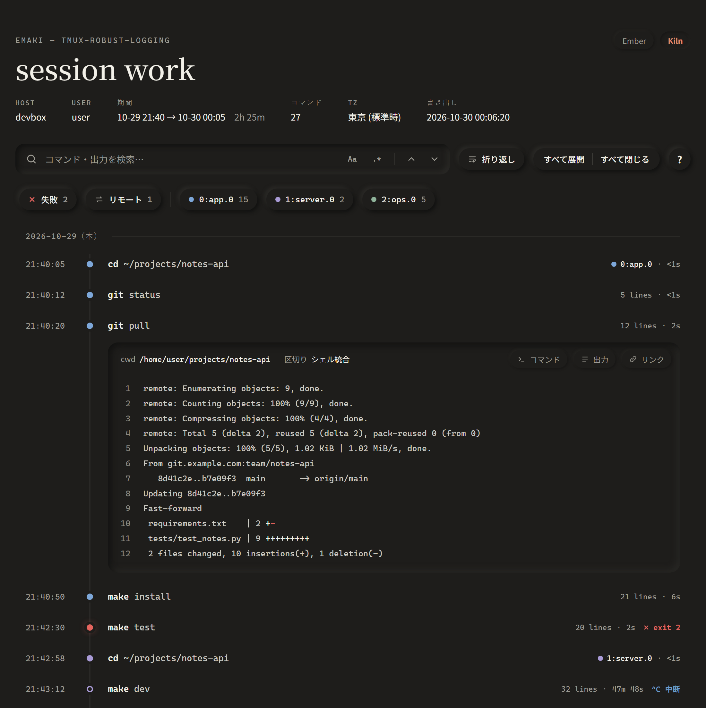
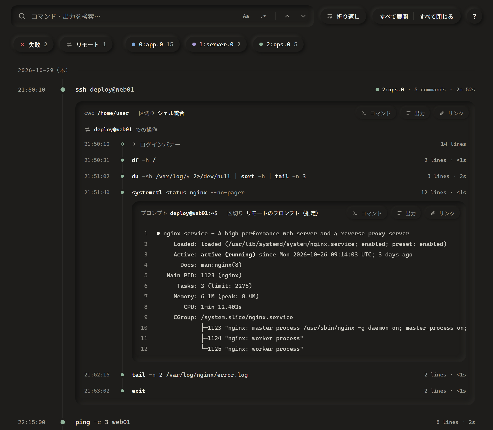
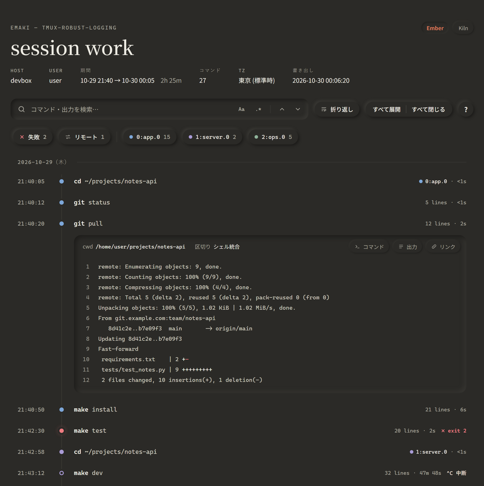

# tmux-robust-logging

[tmux-plugins/tmux-logging](https://github.com/tmux-plugins/tmux-logging) を下敷きに、
**「どの端末に接続していてもログを取りこぼさない」** ことを最優先に作り直したプラグインです。
tmux のペインに表示された出力を、ペインごとにそのまま記録します。
付属の `emaki` コマンドを使えば、セッション単位の 1 枚の HTML にまとめて書き出せます。



<sub>記録したログを付属の `emaki` で 1 枚の HTML にしたところ。</sub>

## 設計方針

- **そのまま記録する**: 端末の出力を `pipe-pane` + `cat` でバイトそのまま raw ログに書くだけ。途中に壊れうる処理を挟まないので、取りこぼしません
- **整形は後から**: 読みやすいログ（`.log`）は、ロギングを止めたときに raw から作ります
- **落ちても残る**: ペインや tmux が突然終わっても raw はディスクに残り、後から自動で回収・整形します
- **状態は tmux に聞く**: ロギング中かどうかは tmux 自身の状態で判断するので、表示と実際がずれません

## 必要環境

- tmux 3.1 以上
- bash と基本的なコマンド（cat・sed・awk）
- あれば使うもの: perl（整形の精度と時刻の記録）、python3 3.7 以上（emaki）、Fira Code フォント（emaki の表示）

## インストール

TPM の場合:

```
set -g @plugin 'yourname/tmux-robust-logging'
```

手動の場合は `.tmux.conf` に:

```
run-shell /path/to/tmux-robust-logging/robust-logging.tmux
```

## キーバインド

| キー | 動作 |
|---|---|
| `prefix + P` | ロギングの開始 / 停止 |
| `prefix + M-p` | 今の画面を保存 |
| `prefix + M-P` | スクロールバック全体を保存 |
| `prefix + M-c` | スクロールバックを消去 |
| `prefix + M-e` | このセッションを HTML に書き出す（[emaki](#emaki-セッションを-1-枚の絵巻に)） |

## emaki: セッションを 1 枚の「絵巻」に

tmux の中で `emaki` と打つと、そのセッションの内容（閉じたペインも含む）を、
コマンドごとに開閉できる 1 枚の HTML に時系列で書き出します。

### ssh の先で打ったコマンドも 1 つずつ追える

ssh・evil-winrm などで**接続した先で打ったコマンドも 1 つずつ切り分けて**、入れ子のタイムラインに並べます。



### 配色は Ember と Kiln から選べる

暖かいチャコールの **Ember** と、黒に近い **Kiln**。右上のボタン（`t` キーでも）で切り替えられます。

 

### そのほか

- 失敗したコマンド・Ctrl-C で止めたコマンドに印が付く
- コマンドと出力をまとめて検索でき、失敗・リモート・ペインごとに表示を絞れる
- vim や less などの全画面アプリの画面は畳んで表示
- 外部依存のない 1 枚の HTML（オフラインで開ける）

### 使い方

```bash
emaki                  # 今のセッションを書き出す（~/tmux-logs/emaki/）
emaki --open           # 書き出してブラウザで開く
emaki -s work          # セッションを指定
emaki --all            # すべてのセッションを 1 枚に
emaki --raw ~/tmux-logs/tmux_work_*.raw.log   # 終わったセッションのログから
emaki -o report.html   # 出力先を指定
```

終わったセッションを後から書き出すなら、`@rl_keep_raw on` で raw を残しておくと正確です。

### シェル統合（推奨）

`~/.zshrc` に 1 行（bash なら `~/.bashrc` に `.bash` 版）:

```bash
source ~/.tmux/plugins/tmux-robust-logging/shell/emaki-integration.zsh
```

`emaki` コマンドが使えるようになり、コマンドの区切りと終了コードが正確になります（入れなくても推定で動きます）。
シェルが出す印には合言葉が付くので、出力に偽の印が紛れ込んでもだまされません。

## オプション

```
set -g @rl_log_dir "~/tmux-logs"           # ログの保存先
set -g @rl_raw_dir "~/tmux-logs/raw"       # raw だけ別の場所に（指定すると raw を残す）
set -g @rl_auto_start on                   # すべてのペインを自動でロギング
set -g @rl_capture_backlog on              # 開始時に今の画面とスクロールバックも取り込む
set -g @rl_keep_raw on                     # 整形後も raw を残す
set -g @rl_timestamp on                    # 各行に日時を付ける（ssh・WinRM の先でも）
set -g @rl_timestamp_format "[%Y-%m-%d %H:%M:%S] "   # 日時の形式
set -g @rl_live_clean 5                    # ロギング中も整形済みログを更新する（最短の間隔・秒）
set -g @rl_max_size_mb 100                 # raw をこのサイズで分割する
set -g @rl_convert_from CP932              # 整形時に UTF-8 へ変換する
set -g @rl_history_escapes on              # 履歴の保存に色を含める
set -g @rl_exit_sweep off                  # tmux 終了時の自動回収を止める
set -g @rl_growth_warn_mb 10               # raw の急な増加を警告する（MB / 2 秒）
set -g @rl_quiet on                        # メッセージを出さない
set -g @rl_key_toggle P                    # キーの変更（@rl_key_screen・_history・_clear・_emaki も）
set -g @rl_emaki_dir "~/tmux-logs/emaki"   # emaki の出力先
set -g @rl_emaki_open on                   # キーで書き出したらブラウザで開く
set -g @rl_emaki_embed_font on             # emaki の HTML にフォントを埋め込む
```

tmux の起動直後から記録するなら、`@rl_auto_start on` と `@rl_capture_backlog on` をプラグインの読み込みより前に書きます。

## 注意

- ロギング中のペインで、そのペインの raw を `cat` や `tail -f` しないでください。自分の出力を読み続けて、ログが増え続けます（見るなら `less -R` か別のペインで）
- ログにはパスワードなどの機密情報が写り込むことがあります。保存先の扱いに気をつけてください
- vim などの全画面アプリは、整形後の `.log` では読みにくくなります。raw を残しておけば `less -R` で見られます

## 困ったとき

```bash
tmux pipe-pane -t %5                         # pipe を閉じる
/path/to/scripts/finalize.sh '%5'            # 整形して片付ける
/path/to/scripts/finalize.sh --sweep         # 残ったものをすべて回収する
/path/to/scripts/sanitize.sh < a.raw.log > a.log   # raw を手で整形する
```
